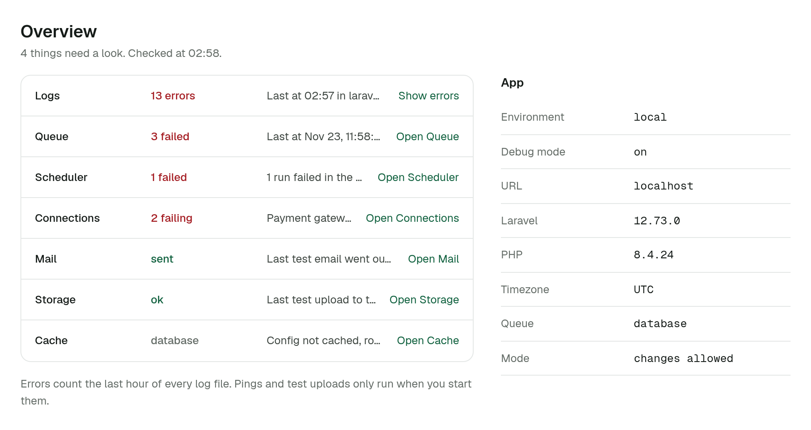

# soara/laravel-debugger

A log viewer and the ops pages every Laravel app ends up needing, on one page at `/debugger`.

**Full documentation: https://labs.soara.id/laravel-debugger**
(until the site is live, read it on GitHub: [English](docs/en/introduction.md) · [Bahasa Indonesia](docs/id/introduction.md))



| Section | What it does |
|---|---|
| **Overview** | One list that shows which parts need a look, with a link to each. |
| **Logs** | Read and search the files in `storage/logs`, filter by level, open an entry for its stack trace. Large files stay fast. |
| **Queue** | Failed jobs with their exception. Retry, Retry all, Delete. Works with every failed job driver. |
| **Scheduler** | Scheduled tasks with their next and last run, and a history of runs (ran, failed, skipped, running). |
| **Cache** | Clear the application, config, route and view caches, or rebuild them. |
| **Mail** | Send a test email through the queue or right away, and see the mailer settings (never the password). |
| **Storage** | Upload a test file to the upload disk, open or delete it, and check each disk. |
| **Connections** | Ping the external APIs your app depends on. |
| **Users** | Log in as another user to see the app the way they see it, then switch back. |

It is not a recorder like Telescope: it reads what your app already has (log files, failed jobs, config) and adds nothing to your app's requests.

## Install

Requires PHP 8.2+ and Laravel 12 or 13 (Laravel 13 needs PHP 8.3+).

```bash
composer require soara/laravel-debugger
php artisan migrate
```

Open `/debugger`. There is nothing to build: the app ships prebuilt with the package and works with or without Inertia, Livewire or Vue.

## Who can open it

Out of the box only the `local` environment can open the debugger. To open it elsewhere, define a gate:

```php
Gate::define('viewDebugger', fn ($user) => in_array($user->email, ['dev@yourapp.com']));
```

Once the gate exists it decides everywhere, including local. See [Access control](docs/en/access-control.md) for `Debugger::auth()` and the impersonation gates.

## Read-only mode

In production the debugger is read-only by default: every page is readable, but actions (Retry, Clear, Send test email, Log in as, …) are turned off. Set `DEBUGGER_READ_ONLY=false` to allow them. See [Read-only mode](docs/en/read-only-mode.md).

## Development

```bash
composer install
npm install
composer dev        # workbench with sample data at http://localhost:8000/debugger,
                    # and dist/ rebuilt on every CSS or JS change
composer serve      # the workbench only
composer test
```

The workbench has a sign-in shortcut at `/workbench/login` and an impersonation demo at `/workbench/impersonate-demo`.

## License

MIT. See [LICENSE](LICENSE).
