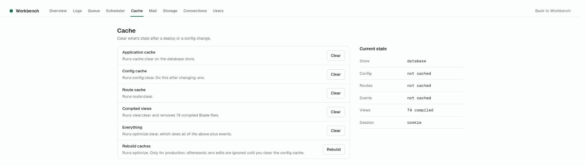

The Cache page runs Laravel's own cache commands from the browser. Handy after a deploy or after changing `.env`.

## Actions

| Row | Button | Command it runs |
| --- | --- | --- |
| Application cache | Clear | `cache:clear` |
| Config cache | Clear | `config:clear` |
| Route cache | Clear | `route:clear` |
| Compiled views | Clear | `view:clear` |
| Everything | Clear | `optimize:clear` |
| Rebuild caches | Rebuild | `optimize` |

Rebuild asks you to confirm first. After a rebuild, changes to `.env` are not picked up until you clear the config cache again. Routes that use closures can make it fail.

Every action is written to the audit log.

## What it shows

Next to the actions is the current state: the cache store, whether config, routes, and events are cached, how many views are compiled, and the session driver.

## Read-only mode

All buttons are turned off. The state stays visible.

## Limits

- `cache:clear` empties the whole default cache store, including other data your app keeps there.
- If your app runs on several servers, the command only runs on the server that handled the request.
