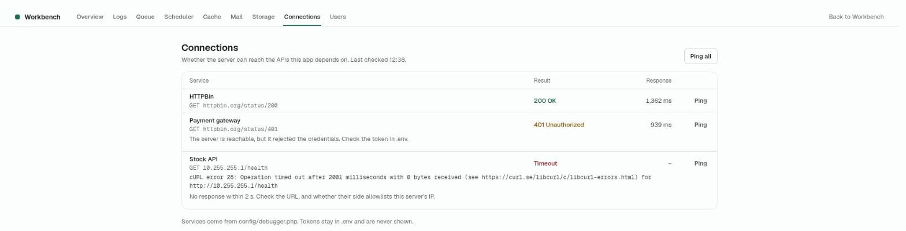

The Connections page checks whether the external APIs your app uses can be reached from the server, and whether they accept the credentials.



## Adding an API

List the APIs in `config/debugger.php`. Tokens stay in `.env`.

```php title="config/debugger.php"
'connections' => [
    'payment' => [
        'name' => 'Payment API',
        'url' => 'https://api.example.com/v1/ping',
        'method' => 'GET',
        'headers' => ['Authorization' => 'Bearer '.env('PAYMENT_API_KEY')],
        'timeout' => 5,
    ],
],
```

- `url`: required.
- `name`: the display name. If empty, it is made from the key.
- `method`: the default is `GET`.
- `headers`: optional.
- `body`: optional, sent as JSON.
- `timeout`: in seconds. The default is `5`.

## Actions

- **Ping**: sends one request to that API.
- **Ping all**: pings every API.

The result:

- Green, for example `200 OK`: the API answered.
- Yellow, `401` or `403`: the API can be reached, but it rejected the credentials.
- Red: any other error, `Timeout`, or `Unreachable`.

For a result that isn't green, the error message and a hint about what to check show under the row. The last result of each API is kept in the cache and used on the [Overview](./overview.md).

## Read-only mode

Ping and Ping all are turned off. The last results stay visible.

## Limits

- Ping really sends a request. Pick an endpoint that is safe to call again and again, like a status or ping endpoint.
- Headers are never shown, but the URL is shown in full. Put tokens in a header, not in the URL's query string.
