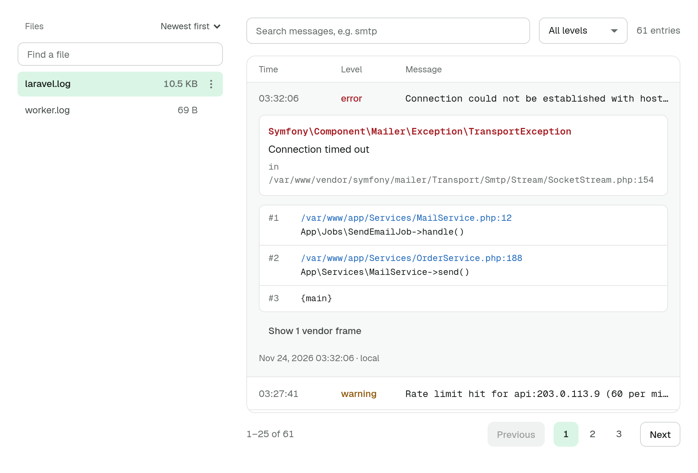

The Logs page reads log files in `storage/logs` straight from disk, without loading a whole file into memory. Files of hundreds of MB still open.

## What it shows

- The log files on the left, with their size. The most recently changed is on top; switch to *Oldest first* above the list, or type part of a name in *Find a file*. Daily logs (`LOG_STACK=daily`) show as one file per day, such as `laravel-2026-11-24.log`.
- The newest log entries on top, with time, level, and message. The entry list scrolls inside the table, as tall as the rest of the window, so the pagination stays in view. On a short screen the list still shows about seven rows and the page scrolls instead.
- The total number of entries, and the count per level in the level filter.

Click an entry to open it. For an exception, you see the class, message, file and line, then the stack trace. Frames from `vendor/` are folded away at first and open with the "Show … vendor frames" button. JSON context is shown neatly formatted.

## Filter and search

- Level filter: emergency, alert, critical, error, warning, notice, info, debug.
- Search looks in the message and body of each entry, ignoring case.

## Related config

- `logs.paths`: which files are read, relative to `storage/logs`. The default is `['*.log', '**/*.log']`.
- `logs.per_page`: entries per page. The default is `25`.

## Actions

Each file in the list on the left has a ⋮ menu.

- **File info**: where the file is, its size, the number of entries, the time of the first entry and when it was last written.
- **Download**: the raw file. It is written to the audit log.

Under a divider, two actions that change the file. Both ask first and are written to the audit log.

- **Clear file**: empties the file. The file stays, and new entries are written to it as usual.
- **Delete file**: removes the file from `storage/logs`. It can't be undone.

## How it works

The first time a file is opened, the debugger builds a small index of where each entry starts and its level. After that, only the part that was appended is read. The index lives in `storage/framework/cache/debugger-logs` and is rebuilt on its own when the file is rotated or emptied.

The next and previous pages are fetched ahead in the background, so Next and Previous feel instant.

## Read-only mode

Clear file and Delete file are turned off. Reading, filtering, search, File info and Download still work.

## Limits

- Only Laravel's own log format (`[2026-11-23 10:00:00] production.ERROR: ...`) is recognised. Other lines count as part of the entry before them.
- Search has to read the whole file. On a large file, the first search takes a while. The results are kept for 2 minutes, so moving between pages of the same search stays fast.
