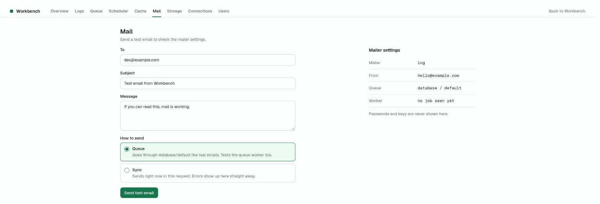

The Mail page sends a test email with your app's mailer, so you know the settings are right before a real email fails.



## Sending a test email

Fill in To, Subject, and Message, then pick how to send it:

- **Queue**: goes through the queue like real emails. Tests the queue worker too.
- **Sync**: sent right now in this request. Errors show up on the page straight away.

Press **Send test email**. If the mailer refuses, its error is shown with passwords and tokens hidden.

If your mailer is `log` or `array`, nothing is actually delivered. The page tells you so.

Every send is written to the audit log.

## Mailer settings

Next to the form are the mailer, host, port, From address, the queue in use, and when the worker last finished a job. Passwords and keys are never shown.

## Locking the recipient

So test emails don't go to just any address, lock the recipient:

```dotenv title=".env"
DEBUGGER_MAIL_TO=dev@yourapp.com
```

Every test email goes to this address, whatever is typed in the form. The form says so.

## Read-only mode

The Send test email button is turned off. The mailer settings stay visible.

## Limits

- Through the Queue, "sent" means the email is on the queue. If it doesn't arrive within a minute, look for a failed job in [Queue](./queue.md).
- The debugger can't tell whether an email actually reached the inbox.
