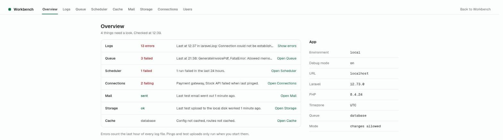

The Overview is the first page you see when you open `/debugger`. It is one list, one row per module, and whatever needs a look is always on top.

## What it shows

The page heading answers right away, for example "Nothing needs a look" or "2 things need a look". Below it, each row has the module name, a short status, one sentence of explanation, and a link to its page.

| Module | Red or yellow when | The sentence says |
| --- | --- | --- |
| Logs | There are errors in the last hour | The time, file name, and message of the last error |
| Queue | There are failed jobs | The time, job name, and last exception |
| Scheduler | `schedule:run` stopped, or a run failed in the last 24 hours | When it last ran |
| Connections | An API failed when last pinged | Which API failed |
| Mail | Never red | When the last test email was sent |
| Storage | Never red | When the last test upload worked |
| Cache | Never red | The store, and whether config and routes are cached |

A red Logs row opens the Logs page with the error filter and the right file.

If `APP_DEBUG` is on in production, a red "debug on" row shows at the very top.

Next to the list is the app info: environment, debug mode, URL, Laravel and PHP versions, timezone, queue, and mode (`read-only` or `changes allowed`).

## How it counts

The Overview only reads what is already known. It doesn't ping APIs, upload, or send email, so the page stays fast.

- Errors are counted in every log file that changed in the last hour. The levels counted are emergency, alert, critical, and error. Counting stops at 500 per file and shows "500+".
- The Connections, Mail, and Storage status comes from the last result when you tested them on their own pages. If you never did, the status is grey "not checked".

## Limits

- The Overview doesn't watch anything in the background. The numbers are worked out when the page opens.
- Modules turned off in the config don't show in the list.
