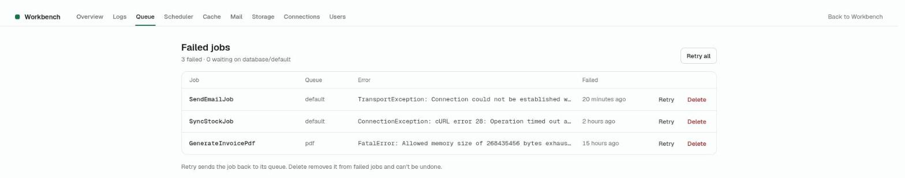

The Queue page shows failed jobs from Laravel's own failer (`queue.failed` in `config/queue.php`). Every failed job driver works: database, database-uuids, file, and dynamodb.

## What it shows

- The number of failed jobs, and the number of jobs waiting when the default queue connection uses the database driver.
- One row per job: job name, queue, the first line of the exception, and when it failed. Newest on top, 25 per page.
- Click a row to see the full class, attempt, connection, id, and the whole exception.

## Actions

- **Retry**: sends the job back to its queue to run again. The same as `queue:retry`.
- **Delete**: removes the job from failed jobs. This can't be undone.
- **Retry all**: sends every failed job back. It asks you to confirm first.

> [!WARNING]
> Jobs that send emails or charge payments will do so again when retried.

Every action is written to the audit log.

## Read-only mode

Retry, Delete, and Retry all are turned off. The list and details stay readable.

## Limits

- To show a page, every failed job is read first and then sorted. If you have thousands of failed jobs, this page gets slower.
- Retry only puts the job back on the queue. Make sure a queue worker is running so the job actually runs.
