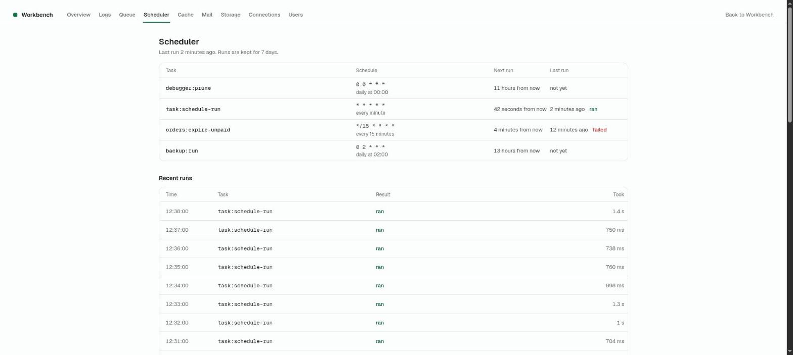

The Scheduler page shows the tasks in `routes/console.php`, when they run next, and a history of every run, including the ones that failed or were skipped.



## What it shows

- One row per task: name or command, the cron expression with a description like "every 5 minutes", the next run, and the last run with its status.
- Recent runs: time, task, status, and duration. 50 per page.
- A notice when `schedule:run` has never run, with the cron line to add on the server.
- A red notice when `schedule:run` hasn't run for longer than `scheduler.late_after_minutes`.

Run statuses:

- `ran`: finished with exit code 0.
- `failed`: an exit code other than 0, or an exception.
- `skipped`: skipped, for example because of `withoutOverlapping()` while the previous run is still going.
- `running`: still going, including `runInBackground()` tasks until they finish.

## How it works

The debugger listens to Laravel's own scheduler events and writes every run to the `debugger_schedule_runs` table. Each time `schedule:run` starts, it also saves the task list. Web requests don't load the schedule, so the task list shows up after the next `schedule:run`.

## Related config

- `scheduler.retention_days`: how many days of history to keep. The default is `7`.
- `scheduler.late_after_minutes`: the default is `3`.
- `scheduler.prune`: schedules `debugger:prune` every day. The default is `true`.

You can also run the cleanup yourself:

```bash
php artisan debugger:prune
```

## Read-only mode

This page only reads. There is no action to run a task from the browser.

## Limits

- The task list is kept in the app's cache. If the cache is cleared, the task list is empty until the next `schedule:run`. The run history stays, since it is stored in the database.
- Runs from before the package was installed are not recorded.
