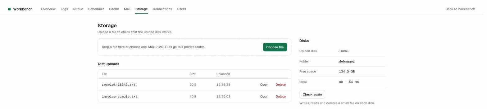

The Storage page checks your app's upload disk, for example S3, with a real test file.



## Uploading a test file

Drop a file on the upload area or press **Choose file**. The file is stored in the `storage.folder` folder on the `storage.disk` disk, with private visibility.

Uploaded files show under Test uploads, with their size and upload time:

- **Open**: opens the file in a new tab.
- **Delete**: removes the file from the disk. It asks you to confirm first.

## Checking disks

Press **Check disks** to write, read back, and delete a small file on the upload disk and the `local` disk. The result is `ok` with how long it took, or `failed` with the disk's error message.

## Related config

- `storage.disk`: the disk for test uploads, set with `DEBUGGER_STORAGE_DISK`. The default is `local`.
- `storage.folder`: the default is `debugger`.
- `storage.max_kb`: the default is `51200` (50 MB), or PHP's `upload_max_filesize` if that is smaller.

```dotenv title=".env"
DEBUGGER_STORAGE_DISK=s3
```

## Security

- Only files in the test folder can be opened or deleted.
- Images, PDFs, video, audio, and text open in the browser with a fixed file type. An HTML file renamed to `.txt` still shows as plain text.
- Other file types are always downloaded.
- An opened file can't run scripts or reach your app.

## Read-only mode

Upload, Delete, and Check disks are turned off. The file list and the Open button still work.

## Limits

- The free space shown is the free space on the app server, not on an upload disk like S3.
