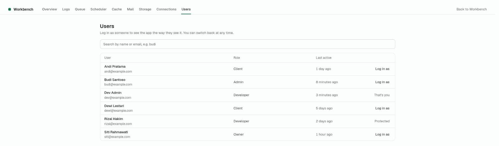

The Users page lists your app's users with a **Log in as** button. Handy for problems only some users have, for example because of their role or data.



## What it shows

- One row per user: name, email, role if you set it up, and when they were last active if `users.columns.last_active` is set. 25 per page.
- A search box, which searches the `users.search` columns.
- Recent sessions: the last 10 impersonations, who logged in as whom and for how long.

Users you can't log in as show no button: "That's you" for your own account, and "Protected" for users the `beImpersonated` gate refuses.

## Log in as

Press **Log in as** on a user. You are signed in as that user and sent to `impersonation.redirect` (the default is `/`).

While impersonating, the app shows a bar at the top of the page: "You're signed in as …" with a button to go back. The bar is added to every HTML page on its own, Inertia apps included. Press its button to go back to your own account.

> [!NOTE]
> The bar doesn't show on JSON responses or redirects. If you turn it off with `impersonation.show_bar`, use `Debugger::impersonation()` to build your own.

```php
use Soara\Debugger\Debugger;

$current = Debugger::impersonation();
// ['id' => ..., 'name' => 'Dev Admin', 'target' => 'Budi', 'started_at' => ...] or null
```

## Showing roles and choosing users

Roles and which users are listed are set in code, so the config stays cacheable:

```php title="app/Providers/AppServiceProvider.php"
use Soara\Debugger\Debugger;

public function boot(): void
{
    // Show a role in the Role column.
    Debugger::userRole(fn ($user) => $user->getRoleNames()->first());

    // Only list active users.
    Debugger::userQuery(fn ($query) => $query->where('is_active', true));
}
```

## Related config

- `users.guard`, `users.model`, `users.columns`, `users.search`. See [Configuration](./configuration.md#users-and-impersonation).
- `impersonation.enabled`, `impersonation.redirect`, `impersonation.show_bar`.
- The `impersonate` and `beImpersonated` gates. See [Access control](./access-control.md#impersonation).

## Read-only mode

Log in as is turned off. The user list stays visible. Going back to your own account still works, so nobody gets stuck in someone else's account.

## Limits

- Impersonation can't be nested. Go back to your own account before logging in as another user.
- If your original account is deleted while impersonating, the back button logs you out.
