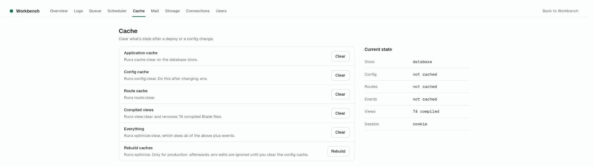

Halaman Cache menjalankan perintah cache bawaan Laravel dari browser. Berguna setelah deploy atau setelah mengubah `.env`.

## Aksi

| Baris | Tombol | Perintah yang dijalankan |
| --- | --- | --- |
| Application cache | Clear | `cache:clear` |
| Config cache | Clear | `config:clear` |
| Route cache | Clear | `route:clear` |
| Compiled views | Clear | `view:clear` |
| Everything | Clear | `optimize:clear` |
| Rebuild caches | Rebuild | `optimize` |

Rebuild meminta konfirmasi dulu. Setelah rebuild, perubahan di `.env` tidak terbaca sampai config cache dikosongkan lagi. Route yang memakai closure bisa membuatnya gagal.

Setiap aksi tercatat di audit log.

## Yang ditampilkan

Di samping daftar aksi ada status saat ini: store cache, apakah config, route, dan event di-cache, jumlah view yang sudah dikompilasi, dan driver session.

## Mode baca-saja

Semua tombol dimatikan. Status tetap terlihat.

## Batasan

- `cache:clear` mengosongkan seluruh store cache bawaan, termasuk data lain yang aplikasi Anda simpan di sana.
- Kalau aplikasi berjalan di beberapa server, perintah hanya jalan di server yang melayani request itu.
