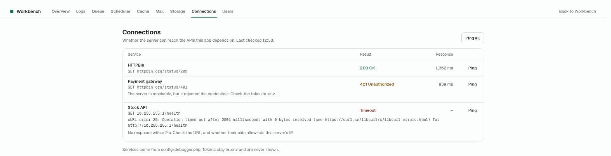

Halaman Connections mengecek apakah API eksternal yang dipakai aplikasi Anda bisa dihubungi dari server, dan apakah kredensialnya diterima.



## Menambahkan API

Daftarkan API di `config/debugger.php`. Token tetap di `.env`.

```php title="config/debugger.php"
'connections' => [
    'payment' => [
        'name' => 'Payment API',
        'url' => 'https://api.example.com/v1/ping',
        'method' => 'GET',
        'headers' => ['Authorization' => 'Bearer '.env('PAYMENT_API_KEY')],
        'timeout' => 5,
    ],
],
```

- `url`: wajib.
- `name`: nama tampilan. Kalau kosong, dibuat dari key-nya.
- `method`: bawaannya `GET`.
- `headers`: opsional.
- `body`: opsional, dikirim sebagai JSON.
- `timeout`: dalam detik. Bawaannya `5`.

## Aksi

- **Ping**: mengirim satu request ke API itu.
- **Ping all**: ping semua API.

Hasilnya:

- Hijau, misalnya `200 OK`: API menjawab.
- Kuning, `401` atau `403`: API bisa dihubungi, tapi kredensialnya ditolak.
- Merah: error lain, `Timeout`, atau `Unreachable`.

Untuk hasil yang tidak hijau, pesan error dan saran apa yang perlu dicek tampil di bawah barisnya. Hasil terakhir tiap API disimpan di cache dan dipakai di [Overview](./overview.md).

## Mode baca-saja

Ping dan Ping all dimatikan. Hasil terakhir tetap terlihat.

## Batasan

- Ping benar-benar mengirim request. Pilih endpoint yang aman dipanggil berulang, misalnya endpoint status atau ping.
- Header tidak pernah ditampilkan, tapi URL ditampilkan utuh. Taruh token di header, jangan di query string URL.
