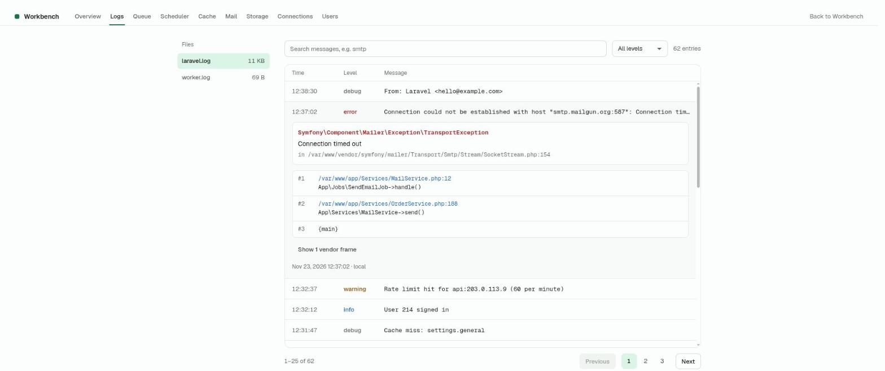

Halaman Logs membaca file log di `storage/logs` langsung dari disk, tanpa memuat seluruh file ke memory. File ratusan MB tetap bisa dibuka.

## Yang ditampilkan

- Daftar file log di kiri, yang terakhir berubah paling atas, dengan ukurannya.
- Entri log terbaru di atas, dengan jam, level, dan pesan. Halaman mengisi layar: yang di-scroll hanya daftar entri, dan pagination tetap terlihat.
- Jumlah total entri dan jumlah per level di filter level.

Klik satu entri untuk membukanya. Untuk exception, Anda melihat class, pesan, file dan baris, lalu stack trace. Frame dari `vendor/` disembunyikan dulu dan bisa dibuka dengan tombol "Show … vendor frames". Context JSON ditampilkan dengan format yang rapi.

## Filter dan pencarian

- Filter level: emergency, alert, critical, error, warning, notice, info, debug.
- Pencarian mencari di pesan dan isi entri, tidak membedakan huruf besar dan kecil.

## Config terkait

- `logs.paths`: pola file yang dibaca, relatif terhadap `storage/logs`. Bawaannya `['*.log', '**/*.log']`.
- `logs.per_page`: jumlah entri per halaman. Bawaannya `25`.

## Cara kerjanya

Saat file pertama kali dibuka, debugger membuat index kecil berisi posisi dan level tiap entri. Setelah itu hanya bagian yang baru ditambahkan yang dibaca. Index disimpan di `storage/framework/cache/debugger-logs` dan dibuat ulang otomatis kalau file dirotasi atau dikosongkan.

Halaman berikutnya dan sebelumnya diambil lebih dulu di belakang layar, jadi Next dan Previous terasa langsung.

## Mode baca-saja

Logs hanya membaca, jadi tidak ada yang berubah di mode baca-saja.

## Batasan

- Hanya format log bawaan Laravel (`[2026-11-23 10:00:00] production.ERROR: ...`) yang dikenali. Baris lain dianggap lanjutan entri sebelumnya.
- Pencarian harus membaca seluruh file. Di file besar, pencarian pertama butuh waktu. Hasilnya diingat 2 menit, jadi pindah halaman pada pencarian yang sama tetap cepat.
- Tidak ada aksi hapus atau kosongkan file log.
