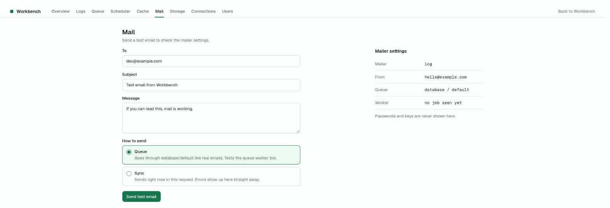

Halaman Mail mengirim email tes memakai mailer aplikasi Anda, jadi Anda tahu setting-nya benar tanpa menunggu email sungguhan gagal.



## Mengirim email tes

Isi To, Subject, dan Message, lalu pilih cara kirim:

- **Queue**: lewat queue seperti email sungguhan. Sekaligus mengetes queue worker.
- **Sync**: langsung dikirim di request ini. Error langsung terlihat di halaman.

Tekan **Send test email**. Kalau mailer menolak, pesan error-nya ditampilkan dengan password dan token disamarkan.

Kalau mailer Anda `log` atau `array`, email tidak benar-benar terkirim. Halaman akan memberi tahu.

Setiap pengiriman tercatat di audit log.

## Setting mailer

Di samping form ada mailer, host, port, alamat From, queue yang dipakai, dan kapan worker terakhir menyelesaikan job. Password dan key tidak pernah ditampilkan.

## Mengunci penerima

Supaya email tes tidak terkirim ke sembarang alamat, kunci penerimanya:

```dotenv title=".env"
DEBUGGER_MAIL_TO=dev@aplikasianda.com
```

Semua email tes akan dikirim ke alamat ini, apa pun yang diketik di form. Form akan menuliskannya.

## Mode baca-saja

Tombol Send test email dimatikan. Setting mailer tetap terlihat.

## Batasan

- Lewat Queue, "terkirim" artinya email masuk antrean. Kalau tidak sampai dalam satu menit, cek failed job di [Queue](./queue.md).
- Debugger tidak bisa tahu apakah email benar-benar sampai di inbox.
