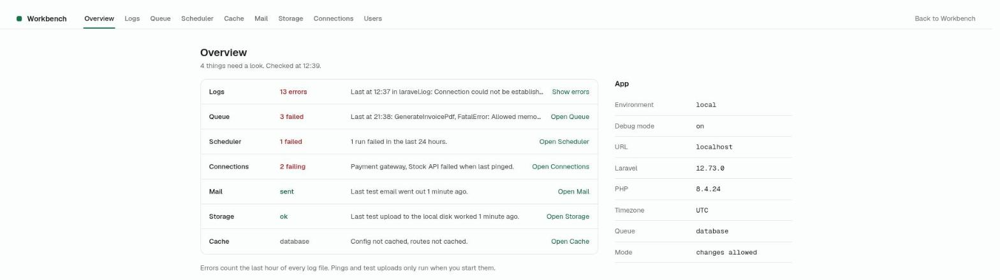

Overview adalah halaman pertama saat Anda membuka `/debugger`. Isinya satu daftar, satu baris per modul, dan yang perlu dicek selalu di atas.

## Yang ditampilkan

Judul halaman langsung menjawab, misalnya "Nothing needs a look" atau "2 things need a look". Di bawahnya, tiap baris berisi nama modul, status singkat, satu kalimat penjelasan, dan link ke halamannya.

| Modul | Merah atau kuning kalau | Isi kalimatnya |
| --- | --- | --- |
| Logs | Ada error dalam 1 jam terakhir | Jam, nama file, dan pesan error terakhir |
| Queue | Ada failed job | Jam, nama job, dan exception terakhir |
| Scheduler | `schedule:run` berhenti, atau ada run gagal dalam 24 jam | Kapan terakhir jalan |
| Connections | Ada API yang gagal saat terakhir di-ping | API mana yang gagal |
| Mail | Tidak pernah merah | Kapan email tes terakhir dikirim |
| Storage | Tidak pernah merah | Kapan upload tes terakhir berhasil |
| Cache | Tidak pernah merah | Store, dan apakah config dan route di-cache |

Baris Logs yang merah membuka halaman Logs dengan filter error dan file yang tepat.

Kalau `APP_DEBUG` menyala di production, muncul baris merah "debug on" paling atas.

Di samping daftar ada info aplikasi: environment, debug mode, URL, versi Laravel dan PHP, timezone, queue, dan mode (`read-only` atau `changes allowed`).

## Cara menghitungnya

Overview hanya membaca yang sudah diketahui. Ia tidak ping API, tidak upload, dan tidak mengirim email, jadi halamannya tetap cepat.

- Error dihitung dari semua file log yang berubah dalam 1 jam terakhir. Level yang dihitung: emergency, alert, critical, dan error. Hitungan berhenti di 500 per file dan ditulis "500+".
- Status Connections, Mail, dan Storage diambil dari hasil terakhir saat Anda mengujinya di halaman masing-masing. Kalau belum pernah, statusnya abu-abu "not checked".

## Batasan

- Overview tidak memantau apa pun di belakang layar. Angkanya dihitung saat halaman dibuka.
- Modul yang dimatikan di config tidak muncul di daftar.
