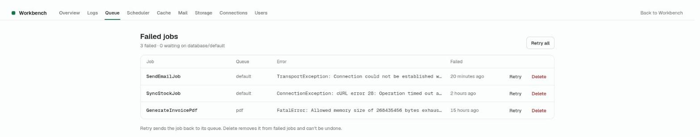

Halaman Queue menampilkan failed job dari failer bawaan Laravel (`queue.failed` di `config/queue.php`). Semua driver failed job didukung: database, database-uuids, file, dan dynamodb.

## Yang ditampilkan

- Jumlah failed job, dan jumlah job yang menunggu kalau koneksi queue bawaan memakai driver database.
- Satu baris per job: nama job, queue, baris pertama exception, dan kapan gagal. Terbaru di atas, 25 per halaman.
- Klik satu baris untuk melihat class lengkap, attempt, koneksi, id, dan exception utuh.

## Aksi

- **Retry**: mengembalikan job ke queue-nya untuk dijalankan lagi. Sama dengan `queue:retry`.
- **Delete**: menghapus job dari failed jobs. Tidak bisa dibatalkan.
- **Retry all**: mengembalikan semua failed job. Ada konfirmasi dulu.

> [!WARNING]
> Job yang mengirim email atau menagih pembayaran akan melakukannya lagi saat di-retry.

Setiap aksi tercatat di audit log.

## Mode baca-saja

Retry, Delete, dan Retry all dimatikan. Daftar dan detail tetap bisa dibaca.

## Batasan

- Untuk menampilkan halaman, semua failed job dibaca dulu lalu diurutkan. Kalau failed job Anda ribuan, halaman ini jadi lebih lambat.
- Retry hanya mengembalikan job ke queue. Pastikan queue worker berjalan supaya job benar-benar dijalankan.
