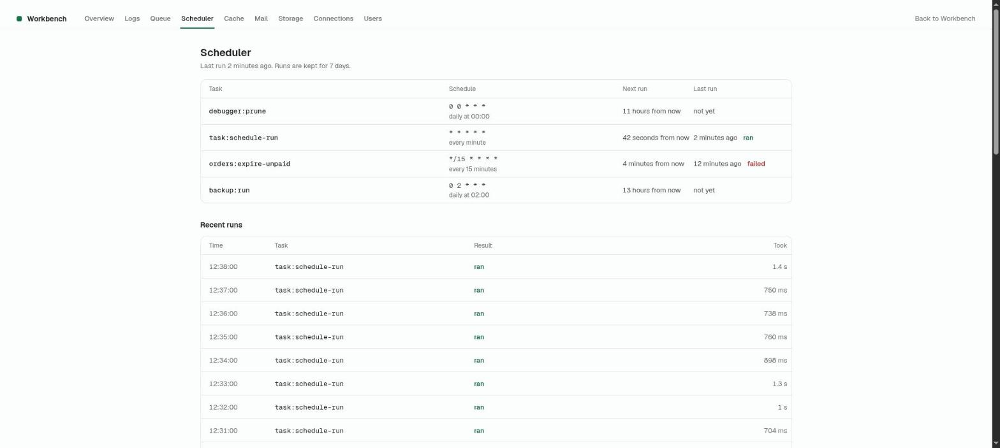

Halaman Scheduler menampilkan task di `routes/console.php`, kapan berikutnya jalan, dan riwayat tiap run, termasuk yang gagal atau dilewati.



## Yang ditampilkan

- Satu baris per task: nama atau command, cron expression dengan penjelasan seperti "every 5 minutes", run berikutnya, dan run terakhir beserta statusnya.
- Recent runs: jam, task, status, dan durasi. 50 per halaman.
- Pemberitahuan kalau `schedule:run` belum pernah jalan, lengkap dengan baris cron yang perlu ditambahkan di server.
- Pemberitahuan merah kalau `schedule:run` tidak jalan lebih lama dari `scheduler.late_after_minutes`.

Status run:

- `ran`: selesai dengan exit code 0.
- `failed`: exit code bukan 0, atau ada exception.
- `skipped`: dilewati, misalnya karena `withoutOverlapping()` dan run sebelumnya belum selesai.
- `running`: masih berjalan, termasuk task `runInBackground()` sampai selesai.

## Cara kerjanya

Debugger mendengarkan event scheduler bawaan Laravel dan mencatat setiap run ke tabel `debugger_schedule_runs`. Setiap kali `schedule:run` mulai, ia juga menyimpan daftar task. Halaman web tidak memuat schedule, jadi daftar task baru muncul setelah `schedule:run` berikutnya.

## Config terkait

- `scheduler.retention_days`: berapa hari riwayat disimpan. Bawaannya `7`.
- `scheduler.late_after_minutes`: bawaannya `3`.
- `scheduler.prune`: menjadwalkan `debugger:prune` setiap hari. Bawaannya `true`.

Anda juga bisa menjalankan pembersihan sendiri:

```bash
php artisan debugger:prune
```

## Mode baca-saja

Halaman ini hanya membaca. Tidak ada aksi menjalankan task dari browser.

## Batasan

- Daftar task disimpan di cache aplikasi. Kalau cache dikosongkan, daftar task kosong sampai `schedule:run` berikutnya. Riwayat run tetap ada karena disimpan di database.
- Run sebelum package dipasang tidak tercatat.
