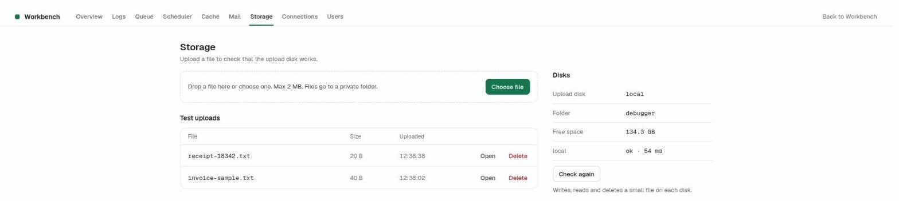

Halaman Storage mengecek disk upload aplikasi Anda, misalnya S3, dengan file tes sungguhan.



## Upload file tes

Tarik file ke area upload atau tekan **Choose file**. File disimpan di folder `storage.folder` pada disk `storage.disk`, dengan visibility private.

File yang sudah diupload muncul di Test uploads, dengan ukuran dan waktu upload:

- **Open**: membuka file di tab baru.
- **Delete**: menghapus file dari disk. Ada konfirmasi dulu.

## Cek disk

Tekan **Check disks** untuk menulis, membaca ulang, lalu menghapus file kecil di disk upload dan disk `local`. Hasilnya `ok` dengan waktunya, atau `failed` dengan pesan error dari disk.

## Config terkait

- `storage.disk`: disk untuk upload tes, lewat `DEBUGGER_STORAGE_DISK`. Bawaannya `local`.
- `storage.folder`: bawaannya `debugger`.
- `storage.max_kb`: bawaannya `51200` (50 MB), atau `upload_max_filesize` PHP kalau lebih kecil.

```dotenv title=".env"
DEBUGGER_STORAGE_DISK=s3
```

## Keamanan

- Hanya file di folder tes yang bisa dibuka atau dihapus.
- Gambar, PDF, video, audio, dan teks dibuka langsung di browser dengan jenis file yang tetap. File HTML yang diganti namanya menjadi `.txt` tetap tampil sebagai teks biasa.
- Jenis file lain selalu diunduh.
- File yang dibuka tidak bisa menjalankan script atau mengakses aplikasi Anda.

## Mode baca-saja

Upload, Delete, dan Check disks dimatikan. Daftar file dan tombol Open tetap bisa dipakai.

## Batasan

- Free space yang ditampilkan adalah ruang kosong di server aplikasi, bukan di disk upload seperti S3.
