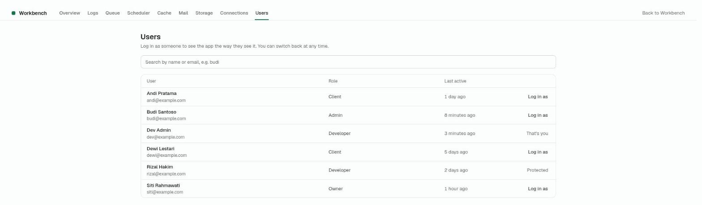

Halaman Users menampilkan user aplikasi Anda dan tombol **Log in as**. Berguna untuk melihat masalah yang hanya dialami user tertentu, misalnya karena peran atau datanya.



## Yang ditampilkan

- Satu baris per user: nama, email, peran kalau Anda mengaturnya, dan kapan terakhir aktif kalau `users.columns.last_active` diisi. 25 per halaman.
- Kotak pencarian, mencari di kolom `users.search`.
- Recent sessions: 10 impersonate terakhir, siapa masuk sebagai siapa dan berapa lama.

User yang tidak bisa dimasuki tampil tanpa tombol: "That's you" untuk akun Anda sendiri, dan "Protected" untuk user yang ditolak gate `beImpersonated`.

## Log in as

Tekan **Log in as** di satu user. Anda masuk sebagai user itu dan diarahkan ke `impersonation.redirect` (bawaannya `/`).

Selama impersonate, aplikasi menampilkan bar di atas halaman: "You're signed in as …" dengan tombol untuk kembali. Bar ini disisipkan otomatis ke setiap halaman HTML, termasuk aplikasi Inertia. Tekan tombolnya untuk kembali ke akun Anda.

> [!NOTE]
> Bar tidak muncul di response JSON atau redirect. Kalau Anda mematikannya lewat `impersonation.show_bar`, pakai `Debugger::impersonation()` untuk membuat bar sendiri.

```php
use Soara\Debugger\Debugger;

$current = Debugger::impersonation();
// ['id' => ..., 'name' => 'Dev Admin', 'target' => 'Budi', 'started_at' => ...] atau null
```

## Menampilkan peran dan memilih user

Peran dan user mana yang tampil diatur lewat kode, supaya config tetap bisa di-cache:

```php title="app/Providers/AppServiceProvider.php"
use Soara\Debugger\Debugger;

public function boot(): void
{
    // Tampilkan peran di kolom Role.
    Debugger::userRole(fn ($user) => $user->getRoleNames()->first());

    // Hanya tampilkan user aktif.
    Debugger::userQuery(fn ($query) => $query->where('is_active', true));
}
```

## Config terkait

- `users.guard`, `users.model`, `users.columns`, `users.search`. Lihat [Konfigurasi](./configuration.md#users-dan-impersonate).
- `impersonation.enabled`, `impersonation.redirect`, `impersonation.show_bar`.
- Gate `impersonate` dan `beImpersonated`. Lihat [Kontrol akses](./access-control.md#impersonate).

## Mode baca-saja

Log in as dimatikan. Daftar user tetap terlihat. Kembali ke akun sendiri tetap bisa, supaya tidak ada yang terjebak di akun orang lain.

## Batasan

- Impersonate tidak bisa bertingkat. Kembali dulu ke akun Anda sebelum masuk sebagai user lain.
- Kalau akun asli Anda dihapus selama impersonate, tombol kembali akan logout.
